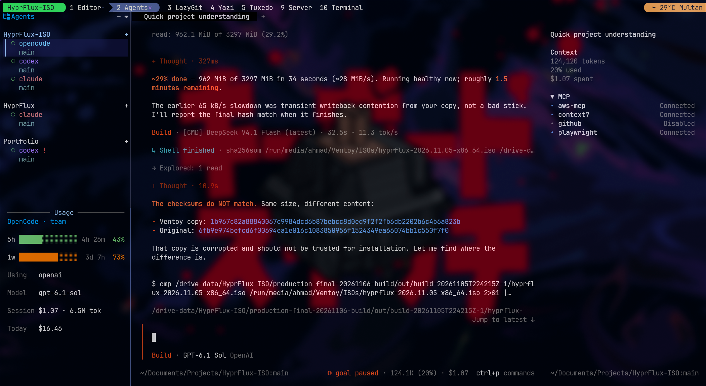
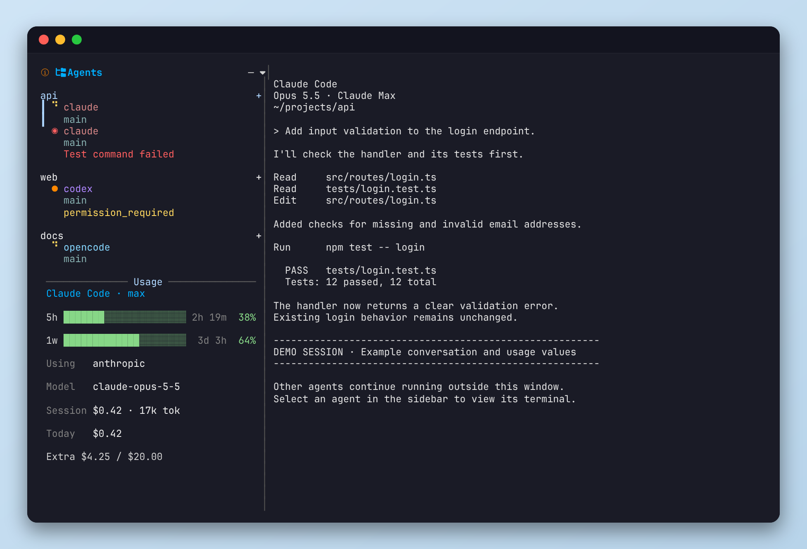
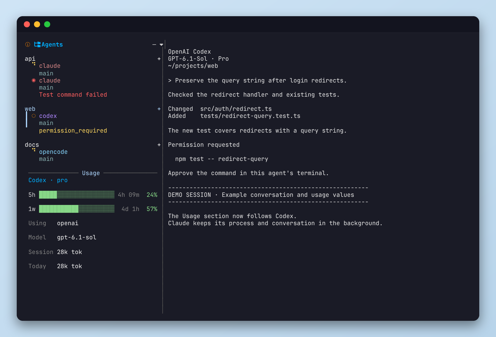

# AgentsTmux

A tmux sidebar for Claude Code, Codex, OpenCode, and Pi.

Keep your agents in one tmux window. Select an agent to show its live terminal beside the sidebar.
Other agents continue to run in the background.

Each tmux session has its own sidebar view. Agent lists, selected rows, and repository filters do not affect other sessions.



Live workspace with OpenCode selected. The sidebar groups agents by folder and shows usage for the visible agent.

<details>
<summary>View the isolated demo capture</summary>



This screenshot shows the real sidebar with an isolated demo session. Conversations and usage values are examples.

</details>

## Features

- **One window for agents.** Switch agents without adding a tmux window for each agent.
  Each agent keeps its process, conversation, and terminal history.
- **Separate sessions.** Each sidebar shows only agents in its own tmux session, including agents in that session's detached holding area.
- **Creation order.** New folders appear below existing folders. New agents appear below existing agents in their folder.
- **Persistent selection.** The visible agent stays highlighted while you type. Keyboard navigation tracks each agent by its pane identity.
- **Usage for the visible agent.** See subscription limits, reset times, model names, and local session usage where available.
- **Status indicators.** Animated indicators show working, background, waiting, ready, and error states. You can change their icons and colors.
- **Notifications and sounds.** Receive completion, question, permission, and error alerts when the source agent is not visible.
  Selecting an existing session does not repeat its completion alert.
- **Folder-based sessions.** Start an agent in an existing folder. AgentsTmux does not create a Git worktree or branch.
- **Compact view.** Prompt and reply previews are hidden by default. Status, branch, and task progress remain visible.

## Requirements

- tmux 3.0 or later
- Git
- Rust and Cargo for source builds
- `curl` for subscription usage requests

Optional tools:

| Tool | Purpose |
|---|---|
| [TPM](https://github.com/tmux-plugins/tpm) | Install AgentsTmux as a tmux plugin |
| Nerd Font | Render the sidebar glyphs |
| `sqlite3` | Read local OpenCode V2 usage and provider credentials |
| `notify-send` and a notification daemon | Show Linux desktop notifications |
| Papirus icons | Supply notification icons, with theme icons as a fallback |
| `hyprctl` | Check whether an agent is visible on an active Hyprland workspace |
| An audio player | Play the bundled alert sounds |

## Installation

### Install with TPM

1. Add this line before the TPM initialization line in `~/.tmux.conf`:

   ```tmux
   set -g @plugin 'ahmad9059/AgentsTmux'
   ```

2. Reload your tmux configuration.
3. Press your tmux prefix, followed by **I**.
4. Select **Build from source** in the installer if a release binary is unavailable.

The plugin configures supported agents that it detects. No separate setup script is necessary.
See [Agent setup](#agent-setup) for agent-specific steps.

### Install manually

1. Clone the repository:

   ```sh
   git clone https://github.com/ahmad9059/AgentsTmux.git ~/.tmux/plugins/AgentsTmux
   ```

2. Build the binary:

   ```sh
   cd ~/.tmux/plugins/AgentsTmux
   cargo build --release
   ```

3. Add the launcher to `~/.tmux.conf`:

   ```tmux
   run-shell ~/.tmux/plugins/AgentsTmux/agents-tmux.tmux
   ```

4. Reload your tmux configuration.

### Open the sidebar

Press your tmux prefix, followed by **e**.

By default, AgentsTmux also creates the sidebar in windows named **Agents** or **Agent**.
This applies to new, renamed, and restored windows. AgentsTmux does not create a sidebar in every window by default.

## Agent setup

Each plugin load runs `agents-tmux integrate --auto` in the background.
The installer skips agents that it does not detect. Repeated runs preserve unrelated settings.
Before changing a file, the installer saves a backup under `~/.local/state/agentstmux/backups/`.

| Agent | Detection | Configuration |
|---|---|---|
| Claude Code | `claude` is on `PATH` | Installs `agents-tmux@agentstmux` from this repository's local marketplace |
| Codex | `~/.codex` exists | Adds lifecycle hooks to `~/.codex/hooks.json` |
| OpenCode V2 | `~/.config/opencode` exists | Links the bundled TUI plugin and adds it to `cli.json` |
| Pi | `~/.pi/agent` exists | Links the bundled extension |

After configuration:

- **Claude Code:** Start a new Claude session to load the plugin.
- **Codex:** Review the new hooks with `/hooks`. Trust the hooks before use. AgentsTmux does not bypass hook trust.
- **OpenCode V2:** Use `/reload` if OpenCode is already running.
  The integration runs in the local client, so events identify the source tmux pane.
- **Pi:** The extension uses the Claude-compatible adapter and badge. Preview text includes the `[Pi]` prefix.

To disable automatic configuration, add this setting before the plugin loads:

```tmux
set -g @agentstmux_auto_setup off
```

To configure agents manually, run:

```sh
agents-tmux integrate --all
```

You can select individual agents with `--claude`, `--codex`, `--opencode`, or `--pi`.

Command examples assume that `agents-tmux` is on `PATH`.
Otherwise, use the binary in `bin/` or `target/release/` inside the plugin folder.

### Existing installations and custom paths

- Disable the old sidebar plugin before using AgentsTmux.
- Disable the old sidebar hooks. AgentsTmux does not remove integrations with different names. Two active integrations can produce duplicate events.
- Do not load `integrations/opencode-v1/agents-tmux.js` in OpenCode V2. That file supports the older OpenCode integration.
- For a custom plugin location, set `AGENTSTMUX_HOOK` to the absolute path of `hook.sh` before starting OpenCode or Pi.

## Controls

| Control | Action |
|---|---|
| **Prefix + e** | Show or hide the sidebar in the current window |
| **Prefix + E** | Show or hide sidebars across windows |
| Click an agent | Show that agent in the right pane |
| **j/k** or arrow keys | Move the sidebar selection |
| **Enter** | Show the selected agent |
| Folder **+** button | Open the new-agent form |
| Agent **×** button | Open removal options |

### Start an agent

1. Select the folder's **+** button.
2. Select the agent and permission mode in the form.
3. Keep the folder path or enter another existing folder.
4. Submit the form.

The form appears in a popup at the center of the window.
The folder field starts with the current folder. It accepts `~` and relative paths.

| Form control | Action |
|---|---|
| **Tab**, **↑**, or **↓** | Move between fields |
| **←** or **→** | Change the agent or permission mode |
| **Ctrl+U** | Clear the folder field |
| **Esc** | Cancel |

To start an agent from a shell, run:

```sh
agents-tmux spawn [folder]
```

### Agent exits and removal

When the visible agent exits or closes, AgentsTmux selects another agent in this order:

1. The agent above it in the same folder.
2. The agent below it in the same folder.
3. The first agent in the nearest folder above.
4. The first agent in the nearest folder below.

AgentsTmux closes the remaining shell if the sidebar originally started that agent.
Closing an agent does not change its folder or close the shared Agents window.

Other agents use a detached tmux session named `__agent-sidebar-*`. Their processes continue to run there.
**Do not kill that session unless you intend to stop those agents.**

The first agent started from a sidebar establishes that window as the session's host.
AgentsTmux does not automatically move agents from existing windows into that host window.

Advanced users can adopt a pane with:

```sh
agents-tmux workspace-select <host-window> <pane> <owner-session>
```

Existing window markers become pane markers before the swap. Moving an existing window from the main tab bar requires a separate tmux operation.

## Usage section

The **Usage** section follows the agent in view. It has no tabs or surrounding box.



Selecting Codex changes the visible terminal and Usage section. This capture uses example data, not a personal account.

| Agent | Available data |
|---|---|
| Claude Code | Five-hour and weekly subscription limits, reset times, plan, and extra usage |
| Codex | Primary and weekly subscription limits, reset times, plan, and credits |
| OpenCode and Pi | Local session usage and subscription limits when their provider supplies them |

The section also shows these details where available:

- **Using:** the provider.
- **Model:** the model name from session data or the agent's visible interface.
- **Session:** reported cost and token usage for the current session.
- **Today:** reported daily cost or token usage.
- **Extra:** additional provider usage or credits.

Token counts are not subscription percentages. AgentsTmux shows costs only when the agent reports them.
It does not estimate missing costs from model prices.

Local data refreshes every 10 seconds. Subscription requests share a 60-second cache across sidebar instances.
Provider retry delays can extend that interval.

After a temporary failure, the section can retain cached bars for up to one hour.
An age label identifies those cached values. If data is unavailable, the section explains why.

OpenCode and Pi use their own provider credentials. AgentsTmux does not substitute an unrelated CLI account.
If Claude's request is rate-limited, an OpenCode credential can supply its limits only after Anthropic verifies the same account and organization.

## Configuration

Add settings to `~/.tmux.conf` before the plugin loads.
AgentsTmux applies defaults only to options that you did not set.
See [`examples/agents-tmux.conf`](examples/agents-tmux.conf) for example overrides.

```tmux
set -g @sidebar_single_window on
set -g @sidebar_width 32
set -g @sidebar_auto_create agents
set -g @sidebar_bottom_height 20
set-environment -g AGENTSTMUX_SHOW_PREVIEWS 0
```

These values are the defaults:

| Setting | Meaning |
|---|---|
| `@sidebar_single_window on` | Use one host window for agents |
| `@sidebar_width 32` | Use a sidebar width of 32 columns |
| `@sidebar_auto_create agents` | Automatically create sidebars only in windows named Agents or Agent |
| `@sidebar_bottom_height 20` | Reserve 20 rows for Usage |
| `AGENTSTMUX_SHOW_PREVIEWS 0` | Hide prompt and reply previews |

Additional options:

- Use a percentage such as `15%` for `@sidebar_width` to size the sidebar relative to the window.
- Set `@sidebar_auto_create on` to create a sidebar in every new window.
- Set `@sidebar_auto_create off` to disable automatic sidebar creation.
- Set `@sidebar_bottom_height 0` to hide Usage.
- Set `AGENTSTMUX_SHOW_PREVIEWS` to `1` to show prompt and reply previews.

### Status indicators and colors

| State | Default indicator |
|---|---|
| Working | Animated yellow braille spinner |
| Background work | Blue orbiting dot |
| Needs attention | Blinking orange dot |
| Ready | Green ring |
| Error | Red dot |

Setting an icon replaces its animation with a static glyph. Color values accept an xterm-256 index or a six-digit hexadecimal value.

```tmux
set -g @sidebar_icon_running '⠋'
set -g @sidebar_icon_idle '○'
set -g @sidebar_color_idle '#98c379'
set -g @sidebar_color_selection '#13142e'
```

These are example overrides, not the complete default configuration.
The sidebar preserves its configured width when the terminal size changes.

### Notifications and sounds

AgentsTmux enables sounds by default. A chime indicates completion.
A double ping indicates a question, permission request, or failure.

Alerts follow these conditions:

- The event's notification setting must be enabled.
- The source agent must not be visible.
- Selecting an old session must not replay its completion alert.

On Hyprland, AgentsTmux suppresses desktop alerts when the source tmux window is visible on an active workspace.
Papirus supplies completion, question, and error icons when available. Otherwise, AgentsTmux uses theme icons.

The binary includes the sounds. Playback uses the first available player from this list:
`pw-play`, `paplay`, `aplay`, `afplay`, `mpv`, `ffplay`, or `play`.

```tmux
set -g @sidebar_sound off
set -g @sidebar_sound_done ~/sounds/finished.wav
set -g @sidebar_sound_request ~/sounds/ask.wav
```

The first setting disables sound. The other settings select custom sound files.

To test the bundled sounds, run:

```sh
agents-tmux play-sound done
agents-tmux play-sound request
```

The script [`scripts/generate-sounds.py`](scripts/generate-sounds.py) generates the bundled sounds.

### Apply updates

After installing a new binary or changing startup-only appearance settings:

1. Hide the sidebar with **Prefix + e**.
2. Show it again with **Prefix + e**.

Your agents can continue to run during the sidebar restart.

## Development

Run these commands from the repository folder:

```sh
cargo fmt
cargo test
cargo clippy
cargo build --release
```

Tests cover agent ordering, selection, session snapshots, notifications, usage data, and interface rendering.

To regenerate the README screenshots, install the website dependencies and a Playwright browser.
Use a Nerd Font to render the sidebar glyphs.
Then run:

```sh
bash scripts/build-readme-captures.sh
```

For a system Chromium installation, set `PLAYWRIGHT_CHROMIUM_EXECUTABLE` to its executable path.
The capture script uses a separate tmux server and demo credentials. It does not change website screenshots or your running agents.

[`tests/workspace_tests.rs`](tests/workspace_tests.rs) includes tests that use a real tmux server.
The standard test suite skips these tests. Run them only against an isolated, disposable tmux server.

The [`website/`](website/) folder contains the documentation site source.
Pages deployment remains manual until you enable GitHub Pages for this repository.
Installation does not require a hosted documentation site.

## License

AgentsTmux uses the MIT license. [`LICENSE`](LICENSE) retains the original copyright notice.

## Credits

AgentsTmux derives from [tmux-agent-sidebar](https://github.com/hiroppy/tmux-agent-sidebar) by [hiroppy (Yuta Hiroto)](https://github.com/hiroppy).
Thank you for the original sidebar, agent adapters, and documentation.

[ahmad9059](https://github.com/ahmad9059) maintains AgentsTmux independently.
AgentsTmux adds the single-window workspace, selection and ordering fixes, compact views, notification changes, and integrations described above.
